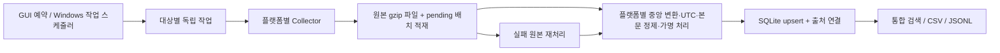

# SCUBA Collector · Windows 커뮤니티 통합 수집기

플랫폼별 Collector와 중앙 정규화 모듈을 분리한 **한국어 데스크톱 프로그램**입니다. Reddit, 디시인사이드, 네이버 카페, ScubaBoard, 앱스토어 그룹을 다루며, Google Play와 App Store는 별도 어댑터로 나눕니다.

수집 대상 관리, 백그라운드 수집, 증분 체크포인트, 원본 보관·재처리, 통합 검색, CSV/JSONL 내보내기, 예약 수집을 제공합니다. 서버나 Docker를 설치하지 않고 한 대의 Windows PC에서 사용할 수 있도록 SQLite를 기본 저장소로 선택했습니다.

## 1. Windows에서 실행

1. **Windows 10/11 64비트**에 [Python 3.11 또는 3.12](https://www.python.org/downloads/windows/)를 설치합니다. 설치 시 **Add python.exe to PATH**를 선택하세요. 일반 배포판의 Tcl/Tk 구성 요소가 필요합니다.
2. ZIP을 압축 해제합니다. ZIP 내부에서 바로 실행하지 마세요.
3. **`START_WINDOWS.bat`를 두 번 클릭**합니다. 첫 실행에는 인터넷 연결이 필요하며 `.venv`와 필수 패키지를 준비합니다.
4. **수집 대상 → 대상 추가**에서 대상 ID/URL을 입력합니다.
5. Reddit·네이버는 **설정·도움말 → API 인증 설정**을 입력합니다.
6. **지금 수집**을 누르고 **실행 기록**에서 결과를 확인합니다.

실제 대상을 입력하기 전에 **설정·도움말 → 가상 시연 모드 전환**을 눌러 화면을 살펴볼 수 있습니다. 시연 데이터는 실제 사용자의 발언이 아닌 합성 예시 6건이며, 별도 `demo` 저장소를 사용합니다.

> 이 배포물은 실행 가능한 Python 소스와 Windows 실행·빌드 스크립트입니다. 미리 빌드한 Windows EXE는 포함하지 않습니다. 현재 제작 환경은 macOS이며, 실제 Windows 실행·DPAPI 검증은 아래 Windows 빌드/CI에서 수행하도록 준비했습니다.

## 2. 수집 대상 입력

| 플랫폼 | 대상 필드 | 인증·실제 수집 범위 |
|---|---|---|
| Reddit | `scuba` 등 서브레딧 이름, `r/` 제외 | 승인된 OAuth API의 최신 글. 댓글 선택 시 글당 설정 건수 및 `replace_more(limit=2)` 범위 |
| Google Play | `com.example.app` 형식의 실제 패키지 ID | 국가·언어별 공개 리뷰. `google-play-scraper`의 RPC 규격을 이용하는 비공식 인터페이스 |
| App Store | 숫자로 된 실제 앱 ID | 국가별 iTunes RSS에 노출되는 최근 리뷰 |
| 디시인사이드 | 실제 갤러리 ID | `board` 일반 / `mgallery` 마이너 / `mini` 미니. 공개 게시글 본문 |
| 네이버 카페 | 검색어 | 공식 검색 API에 노출되는 **검색 요약**. 카페 URL로 결과를 추가 필터링 가능 |
| ScubaBoard | `https://scubaboard.com/community/forums/.../` 또는 `/threads/.../` | 공개 게시판의 스레드·답글. 실제 최종 URL 입력 |

`com.example.app`는 형식 예시이며 실제 앱이 아닙니다. 이 프로그램에는 사전 승인된 API 키나 사용자의 대상 설정이 포함되어 있지 않습니다.

### API 인증

- **Reddit**: 사용 목적에 맞는 API 접근 승인과 `client_id`, `client_secret`, 고유한 `User-Agent`가 필요합니다. User-Agent 예: `windows:scuba.collector:v1.0 (by /u/내계정)`. PRAW의 API 할당량 관리를 사용하며, 같은 실행의 Reddit 대상들은 순차 처리합니다. 고정된 수집 속도를 보장하지 않습니다.
- **네이버**: 개발자 센터에서 검색 API 사용을 등록하고 Client ID와 Client Secret을 입력합니다. 로그인 쿠키나 비공개 모바일 API는 사용하지 않습니다.
- Windows에서 인증 정보는 **현재 로그인한 사용자에게 묶인 DPAPI**로 `credentials.dpapi`에 암호화하여 저장합니다. 다른 사용자/PC로 파일만 복사하면 복호화되지 않을 수 있습니다. 원래 PC에서 설정을 확인하고 새 PC에서 다시 입력하세요.
- 다른 OS에서 GUI로 입력한 인증 정보는 메모리에만 유지됩니다. 환경 변수도 사용할 수 있습니다. 우선순위는 **환경 변수 → GUI 저장값**입니다.

```text
REDDIT_CLIENT_ID
REDDIT_CLIENT_SECRET
REDDIT_USER_AGENT
NAVER_CLIENT_ID
NAVER_CLIENT_SECRET
```

### 수집 범위에서 유의할 점

- **네이버 요약은 본문 전체가 아닙니다.** `extra_metadata.content_scope=search_snippet`으로 표시하고, 미제공 작성자·작성일을 `null`로 저장합니다. API 결과 상한은 검색 시작 위치 기준 1,000입니다. 카페 전체 글이나 회원 전용 글을 수집하지 않습니다.
- **디시 댓글은 자동 수집하지 않습니다.** 권한을 확보한 댓글은 파일로 가져올 수 있습니다. 로그인·캡차·내부 토큰이 필요한 댓글 API 연동은 포함하지 않았습니다.
- App Store RSS는 최근 리뷰의 제한된 창을 제공합니다. 페이지 상한 10을 적용하며, 과거 리뷰 전수 수집은 보장하지 않습니다.
- Google Play의 공개 인터페이스는 공식 지원 API가 아니므로 응답 구조나 제공 범위가 달라질 수 있습니다. 국가·언어를 다르게 설정하면 결과도 달라질 수 있습니다.
- Reddit API의 게시글 목록·댓글 확장 범위도 제한됩니다. 이전 글의 새 댓글을 빠짐없이 추적하거나 삭제 이력을 전체 동기화하는 도구는 아닙니다.
- 공개 HTML은 `robots.txt`를 확인하고 허용되지 않거나 확인할 수 없는 경우 보류합니다. 401/403, 캡차, Cloudflare 챌린지는 해당 수집을 중단합니다. 프록시 회전·TLS 위장·캡차 우회는 포함하지 않았습니다.
- HTML 구조 변경은 파서 오류로 남깁니다. 실제 대상별 동작은 **사용자 대상·API 키 입력 후** 확인해야 합니다.

## 3. 검색과 내보내기

- **통합 데이터**에서 플랫폼과 제목/본문 키워드를 함께 검색합니다. `%`, `_`도 일반 검색 문자로 취급합니다.
- 화면은 200건씩 표시하지만 **내보내기는 현재 필터의 전체 결과**를 저장합니다.
- CSV는 Excel에서 한글을 열 수 있도록 UTF-8 BOM을 포함합니다. 수식으로 해석될 수 있는 셀 앞에는 작은따옴표를 붙입니다. 원래 값이 필요한 경우 JSONL을 사용하세요.
- JSONL은 한 줄에 객체 하나이며, `extra_metadata`를 JSON 객체로 보존합니다.
- 작성일은 UTC입니다. 실행 기록의 시작 시각은 PC의 현지 시간으로 표시합니다.

## 4. 권한 확보 데이터 가져오기

수집 대상에서 해당 플랫폼을 선택한 뒤 **파일 가져오기**로 JSON 배열 또는 JSONL 파일을 엽니다. 파일은 50MB 이하로 나누어 주세요. [예제](examples/authorized_naver.jsonl)는 합성 데이터이므로 실제 조사 결과로 사용하지 마세요.

필수 필드는 `native_id`입니다. `platform`을 넣는 경우 선택한 대상과 일치해야 합니다. `created_at`은 UTC 또는 시간대가 포함된 ISO 8601로 입력하세요. 미제공 시 `null`입니다. 시간대 없는 가져오기 시각은 UTC로 취급합니다.

```json
{
  "native_id": "club123_article456",
  "platform": "naver_cafe",
  "content_type": "post",
  "title": "직접 확보한 글 제목",
  "body": "수집·분석할 권한을 확보한 본문",
  "author": null,
  "created_at": "2026-11-05T09:00:00+09:00",
  "source_url": "https://cafe.naver.com/example/456",
  "extra_metadata": {"content_scope": "authorized_import"}
}
```

기존 정규화 결과의 `id`를 포함하면 같은 ID를 그대로 사용하여 갱신합니다. `id`를 생략하면 플랫폼·대상 범위·native_id를 조합합니다. 댓글에는 `content_type=comment`, 선택적 `parent_id`를 지정할 수 있습니다.

## 5. 저장 위치와 ELT 구조

기본 위치: **`%LOCALAPPDATA%\SCUBACollector`**

```text
SCUBACollector/
  settings.json              수집 대상·운영 설정·가명 처리 salt
  credentials.dpapi          Windows 사용자 전용 암호화 인증 정보
  collector.sqlite3          통합 데이터·체크포인트·실행 이력·원본 처리 상태
  raw/<platform>/<source>/   압축 JSON 원본 봉투(JSON/HTML/RPC 응답)
  demo/                      실제 데이터와 분리한 가상 시연 저장소
```

`SCUBA_COLLECTOR_HOME` 환경 변수 또는 CLI `--home`으로 위치를 바꿀 수 있습니다. 앱이 닫혀 있을 때 폴더 전체를 백업하세요. 실행 중인 SQLite 파일 하나만 복사하면 WAL의 최신 내용이 누락될 수 있습니다.



- **Extract → Load → Transform** 순서로 처리합니다. 원본을 디스크에 원자적으로 저장하고 배치 레코드를 만든 후 변환합니다. 변환 실패 시 원본이 남습니다.
- 레코드 PK에 플랫폼과 필요한 갤러리·앱 범위를 포함해 플랫폼 내부 ID 충돌을 방지합니다. `ON CONFLICT DO UPDATE`로 수정 내용을 반영하고 신규/변경/동일 건수를 구분합니다.
- 출처 연결 테이블로 여러 대상에서 같은 글을 발견해도 데이터 한 건을 공유합니다.
- 회차의 모든 배치가 처리된 뒤 체크포인트를 반영합니다. 중간 실패 시 일부 레코드가 남더라도 커서는 앞서 나가지 않으며 재실행 시 중복을 방지합니다.
- Reddit의 `after`, Google Play의 페이지 토큰, RSS/네이버의 페이지 위치, 디시의 마지막 번호, ScubaBoard의 URL 큐를 저장합니다. RSS·검색 결과·포럼의 페이지는 실시간으로 바뀔 수 있어 완전한 스냅샷이나 무누락 수집을 보장하지 않습니다.
- ScubaBoard는 초기 스캔 후 스레드 첫 페이지와 마지막으로 읽은 페이지부터 새 답글을 확인합니다. 예전 중간 페이지의 수정·삭제 재확인은 전체 체크포인트 초기화 후 수행해야 합니다.
- 한 대상의 오류는 다른 대상에 전파되지 않습니다. 최대 6개 작업 스레드로 실행합니다. 이 버전은 **단일 PC용**이며 Redis/RabbitMQ, Airflow, Docker 컨테이너, PostgreSQL/Elasticsearch 연결은 포함하지 않습니다.
- 같은 저장소는 GUI와 CLI 중 한 프로세스만 사용할 수 있습니다. 동시에 실행하면 오류를 표시해 커서 충돌을 막습니다.

정규화 스키마와 모듈 구조는 [ARCHITECTURE.md](docs/ARCHITECTURE.md)에 정리했습니다.

## 6. 예약·재시도·보관

**GUI 예약 수집**: 운영 설정에서 간격을 정하고 **예약 수집 켜기**를 누릅니다. 첫 예약은 설정한 간격 뒤 시작합니다. 프로그램이 열려 있고 PC가 깨어 있는 동안 동작하며, 작업 완료 후 다음 간격을 계산합니다. 프로그램 재시작 시 예약은 꺼진 상태입니다.

**Windows 작업 스케줄러**: GUI를 닫은 뒤 소스 폴더의 PowerShell에서 다음을 실행합니다. 등록은 자동으로 수행되지 않습니다.

```powershell
powershell -ExecutionPolicy Bypass -File .\scripts\REGISTER_TASK.ps1 -IntervalMinutes 60
```

기본 작업명은 `SCUBACollector`입니다. 현재 로그인 사용자로 등록하며, PC가 켜져 있고 사용자가 로그인되어 있어야 합니다. 제거:

```powershell
Unregister-ScheduledTask -TaskName SCUBACollector -Confirm:$false
```

**오류 처리**: 네트워크/5xx 오류는 최대 3회 시도합니다. 429는 `Retry-After`를 해석해 호스트 대기 시각을 DB에 저장하며, 서버가 지정한 시각 전에는 재요청하지 않습니다. 값이 없으면 15분을 적용합니다. 접근 제한은 자동 우회하지 않습니다. 원본 재처리는 네트워크 요청 없이 실패·대기 배치만 다시 변환합니다.

**보관 기간**: 기본 30일, Reddit은 최대 48시간입니다. 프로그램 시작·수집 시작 시 `fetched_at`이 오래된 레코드와 `loaded_at`이 오래된 원본을 정리합니다. 앱이 꺼진 동안에는 정리가 실행되지 않습니다. 내보낸 파일·백업은 별도로 관리해야 하며, 짧은 보관 기간만으로 원본 플랫폼의 삭제 의무를 모두 충족하는 것은 아닙니다.

**작성자 정보**: 통합 DB는 기본적으로 플랫폼별 HMAC 가명 처리를 사용하지만, 원본에는 작성자 정보가 남습니다. 원본 폴더를 공유할 때 이를 고려하세요. `settings.json`의 salt를 바꾸면 이후 가명값이 달라집니다.

## 7. 명령줄

프로젝트 폴더에서 실행합니다. 처음에는 `START_WINDOWS.bat`로 환경을 준비하세요.

```powershell
# 활성 대상 전체 1회 수집
.\.venv\Scripts\python.exe -m collector --once

# 대상 ID 확인 / 특정 대상만 수집
.\.venv\Scripts\python.exe -m collector --list-sources
.\.venv\Scripts\python.exe -m collector --once --source 대상ID

# 특정 플랫폼만 수집
.\.venv\Scripts\python.exe -m collector --once --platform reddit

# 실패 원본 재처리 / 권한 확보 파일 가져오기
.\.venv\Scripts\python.exe -m collector --replay
.\.venv\Scripts\python.exe -m collector --source 대상ID --import-file .\data.jsonl

# 검색 결과 전체 내보내기
.\.venv\Scripts\python.exe -m collector --export .\reviews.csv --platform google_play --search 버디

# 실제 저장소와 분리된 합성 예시
.\.venv\Scripts\python.exe -m collector --demo --once
.\.venv\Scripts\python.exe -m collector --demo --export .\demo.jsonl
```

성공/이어받기 대기 종료 코드는 `0`, 오류/접근 제한은 `1`입니다. GUI를 열어 둔 채 같은 저장소로 예약 CLI를 실행하면 단일 실행 잠금 때문에 종료 코드 `1`이 됩니다.

## 8. EXE 만들기

**Windows에서** `BUILD_WINDOWS.bat`를 실행합니다. 테스트 후 PyInstaller로 `dist\SCUBACollector\SCUBACollector.exe`를 만듭니다. **`dist\SCUBACollector` 폴더 전체**를 복사해야 합니다. 배포 대상 PC에는 Python 설치가 필요하지 않습니다. 이 빌드는 코드 서명을 포함하지 않습니다.

`.github/workflows/windows.yml`도 제공합니다. 이 폴더를 저장소 루트로 올려 수동 실행하면 Windows에서 테스트, GUI smoke, DPAPI 검증, EXE 빌드와 CLI smoke를 수행하고 빌드 폴더를 아티팩트로 남깁니다. 이 세션에서 원격 CI를 실행하거나 저장소에 업로드하지는 않았습니다.

로컬 개발 검증:

```powershell
python -m pip install -r requirements.txt
python -m unittest discover -s tests -v
python scripts/gui_smoke.py
```

현재 검증 범위와 실제 연동에 필요한 항목은 [VALIDATION.md](docs/VALIDATION.md)를 참고하세요.

## 참고한 인터페이스 문서

- [Reddit Data API Wiki](https://support.reddithelp.com/hc/en-us/articles/16160319875092-Reddit-Data-API-Wiki): OAuth, User-Agent, 할당량, 삭제된 데이터 처리 원칙.
- [PRAW Quick Start](https://praw.readthedocs.io/en/stable/getting_started/quick_start.html): 읽기 API 사용 방식. 이 프로그램은 고정 버전 7.8.2를 사용합니다.
- [네이버 카페글 검색 API](https://developers.naver.com/docs/serviceapi/search/cafearticle/cafearticle.md): 검색 결과, 요약 필드와 페이지 범위.
- [google-play-scraper 원본 저장소](https://github.com/JoMingyu/google-play-scraper): 리뷰 RPC 형식과 페이지 토큰.
